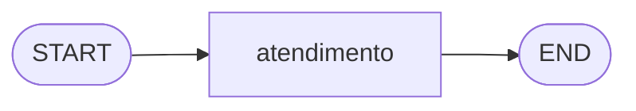

# susia

Sistema multiagente, construído com [LangGraph](https://langchain-ai.github.io/langgraph/), que recebe um prontuário médico e faz a triagem do atendimento.

> Projeto didático. Use apenas prontuários fictícios: ele não substitui avaliação clínica e não deve ser usado com dados reais de pacientes.

## Como funciona

O objetivo final é encaminhar cada prontuário para o agente certo:

- **urgente** → agente de emergência
- **não urgente** → agente clínico geral

### Etapa atual

Por enquanto existe um único agente, o **atendimento**, que lê o prontuário e classifica a urgência:



O nó `atendimento` pede ao modelo uma resposta estruturada com dois campos, `urgencia` e `justificativa`, e grava ambos no state. Na dúvida, o prompt orienta a classificar como urgente.

### Próximas etapas

- Aresta condicional que roteia pelo campo `urgencia`.
- Nós `emergencia` e `clinico_geral`.

## State

Definido em [src/state.py](src/state.py):

| Campo | Origem | Descrição |
|---|---|---|
| `paciente_id` | entrada | ID do paciente |
| `prontuario` | entrada | Texto do prontuário médico |
| `data_atualizacao` | entrada | Data da última atualização do prontuário |
| `urgencia` | atendimento | `"urgente"` ou `"nao_urgente"` |
| `justificativa` | atendimento | Motivo da classificação |

## Estrutura

```
susia/
├── langgraph.json        # registra o grafo para o LangGraph Studio
├── requirements.txt
├── .env.example          # modelo das variáveis de ambiente
└── src/
    ├── state.py          # state compartilhado entre os nós
    ├── graph.py          # montagem do grafo (exporta `grafo`)
    ├── nodes/
    │   └── atendimento.py  # agente de triagem
    ├── edges/            # arestas condicionais (próxima etapa)
    ├── tools/            # ferramentas dos agentes (ainda vazio)
    └── services/
        └── llm.py        # cliente do modelo e configurações
```

`src/services/llm.py` é o único ponto do projeto que conhece o provedor do modelo; os nós só chamam `modelo()`.

## Instalação

Requer Python 3.12 e [uv](https://docs.astral.sh/uv/).

```bash
uv venv --python 3.12
```

```bash
uv pip install -r requirements.txt
```

## Configuração

Copie o modelo e preencha os valores:

```bash
cp .env.example .env
```

O modelo é acessado pela API v1 do Microsoft Foundry. São usadas três variáveis:

| Variável | Valor |
|---|---|
| `AZURE_OPENAI_ENDPOINT` | Endpoint v1 do recurso, terminando em `/openai/v1/`. Exemplo: `https://<recurso>.services.ai.azure.com/openai/v1/` |
| `AZURE_OPENAI_API_KEY` | Chave do recurso |
| `AZURE_OPENAI_CHAT_DEPLOYMENT` | Nome do deployment criado no Foundry (nem sempre igual ao nome do modelo) |

Observações:

- O endpoint não deve incluir `/responses` nem `/chat/completions` no final.
- O cliente usa a Responses API, exigida pelos modelos da família gpt-5/codex.
- As demais variáveis do `.env.example` (`AZURE_OPENAI_API_VERSION`, OpenAI, Gemini, Azure AI Search, MLflow) ainda não são usadas pelo código.

## Como rodar

### Pelo Python

```bash
.venv/bin/python -c "from src.graph import grafo; print(grafo.invoke({'paciente_id': 'PAC-001', 'prontuario': 'Homem, 58 anos. Dor toracica em aperto ha 40 min, sudorese, PA 90x60, SpO2 91%.', 'data_atualizacao': '2026-11-15'}))"
```

A saída é o state final, com `urgencia` e `justificativa` preenchidos.

### Pelo LangGraph Studio

```bash
.venv/bin/langgraph dev
```

O comando sobe a API local em `http://127.0.0.1:2024` e abre o Studio no navegador (pede login em uma conta LangSmith). Selecione o grafo `atendimento`, preencha a entrada e clique em **Submit**.

Exemplo de entrada:

```json
{
  "paciente_id": "PAC-004",
  "prontuario": "Mulher, 34 anos. Retorno para renovação de receita de anticoncepcional oral. Sem queixas. PA 110x70 mmHg, FC 72 bpm, afebril.",
  "data_atualizacao": "2026-11-15"
}
```

## Visualizar o grafo

```bash
.venv/bin/python -c "from src.graph import grafo; print(grafo.get_graph().draw_mermaid())"
```

O comando imprime o diagrama em Mermaid, que pode ser colado em qualquer visualizador Mermaid.
