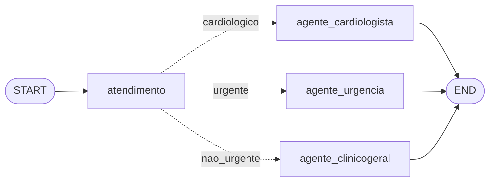

# susia

Sistema multiagente, construído com [LangGraph](https://langchain-ai.github.io/langgraph/), que recebe um prontuário médico e faz a triagem do atendimento.

> Projeto didático. Use apenas prontuários fictícios: ele não substitui avaliação clínica e não deve ser usado com dados reais de pacientes.

## Como funciona

O objetivo final é encaminhar cada prontuário para o agente certo:

- **cardiológico** → agente cardiologista
- **urgente** → agente de emergência
- **não urgente** → agente clínico geral

### Etapa atual



- **`atendimento`**: lê o prontuário e pede ao modelo uma resposta estruturada com `urgencia`, `especialidade` (`"cardiologia"` ou `"geral"`) e `justificativa`. Na dúvida, o prompt orienta a classificar como urgente.
- **Roteamento** ([src/edges/roteamento.py](src/edges/roteamento.py)): casos de cardiologia vão para o `agente_cardiologista`, mesmo quando urgentes; os demais urgentes vão para o `agente_urgencia`; os não urgentes vão para o `agente_clinicogeral`.
- **`agente_cardiologista`**: agente com tool calling que separa os sintomas, consulta o CID-10 com `buscar_cid10` e emite um `parecer_cardiologico` com hipótese diagnóstica, risco (`alto`, `moderado` ou `baixo`) e condutas iniciais. Recebe também a classificação de urgência da triagem.
- **`agente_clinicogeral`**: atende os prontuários não urgentes e não cardiológicos. Mesmo padrão do cardiologista (tool calling com `buscar_cid10`), emitindo um `parecer_clinico` com hipótese diagnóstica, orientações, exames e retorno. Se o prontuário não tiver queixas (por exemplo, renovação de receita), não faz buscas e devolve sintomas e CIDs vazios.
- **`agente_urgencia`**: só roda para prontuários urgentes que não são cardiológicos. É um agente com tool calling: separa os sintomas e sinais do prontuário, consulta o CID-10 com a ferramenta `buscar_cid10` (uma chamada por sintoma) e devolve `sintomas` e `cids_sugeridos`. O prompt proíbe sugerir código que a ferramenta não devolveu.

### RAG sobre o CID-10

A base de conhecimento é o arquivo `CID-10.pdf`, na raiz do projeto: a lista de categorias de 3 caracteres do CID-10 (versão 2008 do Ministério da Saúde), no formato `código + descrição`.

- Cada categoria vira um documento (2.045 no total); não há divisão por tamanho de texto.
- Na primeira busca, os embeddings são gerados e o índice é salvo em `.cache/cid10_index.json` (cerca de 80 MB, fora do git). Essa primeira vez pode levar alguns minutos, conforme o limite de requisições do deployment. Nas seguintes, o índice é só lido do disco. Para refazer o índice, apague esse arquivo.
- A busca é por similaridade semântica, com `InMemoryVectorStore`.

Limitação: o PDF traz só o nome de cada categoria, sem descrição de sintomas por doença. A busca casa o sintoma com nomes de categorias, e funciona melhor para os códigos do capítulo R (sintomas e sinais).

## State

Definido em [src/state.py](src/state.py):

| Campo | Origem | Descrição |
|---|---|---|
| `paciente_id` | entrada | ID do paciente |
| `prontuario` | entrada | Texto do prontuário médico |
| `data_atualizacao` | entrada | Data da última atualização do prontuário |
| `urgencia` | atendimento | `"urgente"` ou `"nao_urgente"` |
| `especialidade` | atendimento | `"cardiologia"` ou `"geral"` |
| `justificativa` | atendimento | Motivo da classificação |
| `sintomas` | agente que atendeu o caso | Sintomas e sinais separados do prontuário |
| `cids_sugeridos` | agente que atendeu o caso | Lista de `sintoma`, `codigo` e `descricao` do CID-10 |
| `parecer_cardiologico` | agente_cardiologista | `hipotese_diagnostica`, `risco` e `condutas` |
| `parecer_clinico` | agente_clinicogeral | `hipotese_diagnostica`, `orientacoes`, `exames` e `retorno` |

## Estrutura

```
susia/
├── CID-10.pdf            # base de conhecimento do RAG
├── langgraph.json        # registra o grafo para o LangGraph Studio
├── requirements.txt
├── .env.example          # modelo das variáveis de ambiente
└── src/
    ├── state.py          # state compartilhado entre os nós
    ├── graph.py          # montagem do grafo (exporta `grafo`)
    ├── nodes/
    │   ├── atendimento.py      # agente de triagem
    │   ├── agente_urgencia.py       # agente que separa sintomas e consulta o CID-10
    │   ├── agente_cardiologista.py  # parecer cardiológico com consulta ao CID-10
    │   └── agente_clinicogeral.py   # parecer de clínica geral com consulta ao CID-10
    ├── edges/
    │   └── roteamento.py       # aresta condicional da triagem
    ├── tools/
    │   └── cid10.py            # ferramenta `buscar_cid10`
    └── services/
        ├── llm.py        # clientes do modelo de chat e de embeddings, configurações
        └── cid10.py      # leitura do PDF, índice vetorial e busca
```

`src/services/llm.py` é o único ponto do projeto que conhece o provedor do modelo; os nós só chamam `modelo()`.

## Instalação

Requer Python 3.12 e [uv](https://docs.astral.sh/uv/).

```bash
uv venv --python 3.12
```

```bash
uv pip install -r requirements.txt
```

## Configuração

Copie o modelo e preencha os valores:

```bash
cp .env.example .env
```

Os modelos são acessados pela API v1 do Microsoft Foundry. São usadas quatro variáveis:

| Variável | Valor |
|---|---|
| `AZURE_OPENAI_ENDPOINT` | Endpoint v1 do recurso, terminando em `/openai/v1/`. Exemplo: `https://<recurso>.services.ai.azure.com/openai/v1/` |
| `AZURE_OPENAI_API_KEY` | Chave do recurso |
| `AZURE_OPENAI_CHAT_DEPLOYMENT` | Nome do deployment do modelo de chat no Foundry (nem sempre igual ao nome do modelo) |
| `AZURE_OPENAI_EMBEDDING_DEPLOYMENT` | Nome do deployment de embeddings. Se omitida, vale `text-embedding-3-small` |

Observações:

- O endpoint não deve incluir `/responses` nem `/chat/completions` no final.
- O cliente usa a Responses API, exigida pelos modelos da família gpt-5/codex.
- As demais variáveis do `.env.example` (`AZURE_OPENAI_API_VERSION`, OpenAI, Gemini, Azure AI Search, MLflow) ainda não são usadas pelo código.

## Como rodar

### Pelo Python

```bash
.venv/bin/python -c "from src.graph import grafo; print(grafo.invoke({'paciente_id': 'PAC-001', 'prontuario': 'Homem, 58 anos. Dor toracica em aperto ha 40 min, sudorese, PA 90x60, SpO2 91%.', 'data_atualizacao': '2026-11-15'}))"
```

A saída é o state final, com `urgencia`, `especialidade` e `justificativa` preenchidos. Conforme o ramo, vêm também `sintomas` e `cids_sugeridos` e o parecer do agente: `parecer_cardiologico` ou `parecer_clinico`.

### Pelo LangGraph Studio

```bash
.venv/bin/langgraph dev
```

O comando sobe a API local em `http://127.0.0.1:2024` e abre o Studio no navegador (pede login em uma conta LangSmith). Selecione o grafo `atendimento`, preencha a entrada e clique em **Submit**.

Exemplo de entrada:

```json
{
  "paciente_id": "PAC-004",
  "prontuario": "Mulher, 34 anos. Retorno para renovação de receita de anticoncepcional oral. Sem queixas. PA 110x70 mmHg, FC 72 bpm, afebril.",
  "data_atualizacao": "2026-11-15"
}
```

## Visualizar o grafo

```bash
.venv/bin/python -c "from src.graph import grafo; print(grafo.get_graph().draw_mermaid())"
```

O comando imprime o diagrama em Mermaid, que pode ser colado em qualquer visualizador Mermaid.
