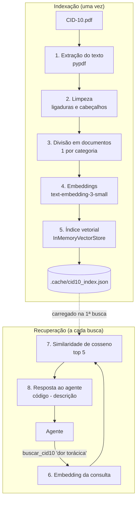

# RAG sobre o CID-10

Este documento explica, passo a passo, como o projeto transforma o arquivo `CID-10.pdf` em uma base de conhecimento pesquisável e como os agentes recuperam informação dela durante a execução do grafo.

Os números citados foram medidos no próprio projeto, com o `CID-10.pdf` atual e o modelo `text-embedding-3-small`.

## Visão geral

O RAG (Retrieval-Augmented Generation) tem duas fases:

1. **Indexação**: acontece uma vez. O PDF é lido, limpo, dividido em documentos, convertido em vetores (embeddings) e salvo em disco.
2. **Recuperação**: acontece a cada execução. O agente pede uma busca por sintoma, o sintoma vira um vetor e o índice devolve as categorias mais parecidas.



Arquivos envolvidos:

| Arquivo | Papel |
|---|---|
| `CID-10.pdf` | Fonte dos dados |
| [src/services/cid10.py](../src/services/cid10.py) | Extração, limpeza, divisão, índice e busca |
| [src/services/llm.py](../src/services/llm.py) | Cliente de embeddings (`embeddings()`) |
| [src/tools/cid10.py](../src/tools/cid10.py) | Ferramenta `buscar_cid10`, exposta aos agentes |
| [src/nodes/agente_urgencia.py](../src/nodes/agente_urgencia.py), [src/nodes/agente_cardiologista.py](../src/nodes/agente_cardiologista.py) e [src/nodes/agente_clinicogeral.py](../src/nodes/agente_clinicogeral.py) | Agentes que usam a ferramenta |

---

## Fase 1: indexação

Tudo acontece em `indice()`, em `src/services/cid10.py`. A primeira busca dispara a indexação; nas seguintes, o índice já está em memória ou em disco.

### Passo 1: conhecer a fonte

O `CID-10.pdf` é a lista de categorias do CID-10 com código de 3 caracteres, na versão 2008 do Ministério da Saúde. São 62 páginas em formato de tabela, com uma categoria por linha:

```
Código Descrição do CID
A00 Cólera
A01 Febres tifóide e paratifóide
A02 Outras infecções por Salmonella
```

Essa estrutura define todo o resto: a unidade natural de informação é **uma linha = uma categoria**.

O PDF não traz descrição clínica das doenças (sintomas, critérios, tratamento). A base sabe, por exemplo, que `I21` é "Infarto agudo do miocárdio", mas não sabe que infarto causa dor torácica.

### Passo 2: extrair o texto

```python
texto = "\n".join(pagina.extract_text() for pagina in PdfReader(PDF_CID10).pages)
```

O `pypdf` lê cada página e devolve o texto. Resultado: 2.151 linhas de texto bruto.

### Passo 3: limpar o texto

O texto extraído tem dois problemas.

**Ligaduras corrompidas.** O PDF usa um caractere único para "fi" e "fl" (as ligaduras tipográficas), e o `pypdf` o extrai como um caractere nulo (`\x00`). São 539 ocorrências, que deixam as palavras quebradas:

| Extraído | Correto |
|---|---|
| `classi\x00cadas` | classificadas |
| `in\x00amatórios` | inflamatórios |
| `sí\x00lis` | sífilis |

Sem essa correção, "inflamação" no índice não seria parecida com "inflamação" na consulta. A função `_restaurar_ligaduras` troca o nulo por "fl" em trechos conhecidos (`TRECHOS_FL`: inflamação, influenza, refluxo, tromboflebite etc.) e por "fi" em todos os outros casos.

**Cabeçalhos repetidos.** Cada página repete linhas como "Código Descrição do CID" e "Classificação Internacional de Doenças - CID 10". São 66 linhas descartadas, listadas em `CABECALHOS`.

### Passo 4: dividir em documentos (chunking)

Em vez de cortar o texto em pedaços de tamanho fixo (o chunking mais comum), o projeto usa a estrutura da fonte: **cada categoria vira um documento**.

A expressão regular `LINHA_CATEGORIA` reconhece o início de uma categoria:

```python
LINHA_CATEGORIA = re.compile(r"^([A-Z]\d{2})(?:\s+(.+))?$")
#                               código    descrição (opcional)
```

O laço percorre as linhas e:

- se a linha começa com um código (`A00`, `R07`...), abre uma nova categoria (2.045 linhas);
- se não começa, é a continuação de uma descrição longa que quebrou de linha no PDF, e é colada na categoria anterior (40 linhas).

Exemplo de continuação: no PDF, a categoria `A18` aparece com o código sozinho numa linha e a descrição na linha seguinte. O laço junta as duas em `A18 Tuberculose de outros órgãos`.

Cada categoria vira um `Document` do LangChain:

```python
Document(
    page_content="A01 Febres tifóide e paratifóide",       # texto que vira embedding
    metadata={"codigo": "A01", "descricao": "Febres tifóide e paratifóide"},  # dados devolvidos na busca
)
```

Resultado: **2.045 documentos**, um por categoria, sem repetição de código.

Por que não usar chunks de tamanho fixo? Um chunk de, por exemplo, 500 caracteres juntaria umas dez categorias diferentes num único vetor, e a busca por "dor no peito" devolveria um bloco misturando doenças sem relação. Com um documento por categoria, cada resultado é exatamente um código.

### Passo 5: gerar os embeddings

Um embedding é um vetor de números que representa o significado de um texto: textos com sentido parecido geram vetores próximos.

```python
store = InMemoryVectorStore(embeddings())
store.add_documents(carregar_categorias())
```

`add_documents` envia o `page_content` de cada documento ao modelo `text-embedding-3-small`, implantado no Microsoft Foundry (o cliente está em `embeddings()`, em `src/services/llm.py`, e usa o mesmo endpoint e chave do modelo de chat). Cada categoria vira um vetor de **1.536 dimensões**.

Essa é a etapa demorada: foram cerca de 2 minutos para as 2.045 categorias, conforme o limite de requisições do deployment.

### Passo 6: salvar o índice

```python
store.dump(str(ARQUIVO_INDICE))   # .cache/cid10_index.json
```

O índice é gravado em JSON, com um registro por documento:

```json
{
  "id": "...",
  "vector": [0.0123, -0.0456, ...],          // 1.536 números
  "text": "R07 Dor de garganta e no peito",
  "metadata": {"codigo": "R07", "descricao": "Dor de garganta e no peito"}
}
```

O arquivo tem cerca de 80 MB e fica fora do git (`.cache/` está no `.gitignore`). Nas execuções seguintes, `indice()` encontra o arquivo e só carrega (`InMemoryVectorStore.load`), o que leva menos de 1 segundo, sem chamar o modelo de embeddings para os documentos.

Para refazer o índice (por exemplo, depois de trocar o PDF ou o modelo de embeddings), apague `.cache/cid10_index.json`. O índice antigo não é invalidado automaticamente: se o PDF mudar e o arquivo continuar lá, a busca usará os dados antigos.

O `@lru_cache` em `indice()` garante que, dentro de um mesmo processo, o índice é carregado uma única vez e reaproveitado por todas as buscas.

---

## Fase 2: recuperação

### Passo 7: o agente decide buscar

Os nós `agente_urgencia`, `agente_cardiologista` e `agente_clinicogeral` são agentes ReAct (`create_agent`, de `langchain.agents`) com a ferramenta `buscar_cid10`. O prompt manda:

1. separar os sintomas do prontuário;
2. chamar `buscar_cid10` uma vez por sintoma;
3. escolher, para cada sintoma, um código **entre os devolvidos pela ferramenta**, nunca inventado.

É o modelo que decide quantas buscas fazer e com quais termos. O clínico geral, por exemplo, não faz nenhuma busca quando o prontuário não tem queixas (uma renovação de receita). Num prontuário de dor torácica, por exemplo, o agente fez 7 chamadas:

```
buscar_cid10(sintoma="dor toracica")
buscar_cid10(sintoma="sudorese")
buscar_cid10(sintoma="nausea")
...
```

O que o modelo sabe sobre a ferramenta vem da sua docstring, em `src/tools/cid10.py`: buscar um sintoma por chamada, em linguagem médica.

### Passo 8: transformar a consulta em vetor e comparar

```python
indice().similarity_search(consulta, k=5)
```

1. O texto da consulta (por exemplo, "dor no peito") é enviado ao mesmo modelo de embeddings e vira um vetor de 1.536 dimensões. Usar o mesmo modelo da indexação é obrigatório; vetores de modelos diferentes não são comparáveis.
2. O `InMemoryVectorStore` calcula a **similaridade de cosseno** entre esse vetor e os 2.045 vetores do índice (por isso o projeto depende de `numpy`).
3. Os 5 documentos com maior similaridade são devolvidos, do mais ao menos parecido.

Exemplo real para "dor no peito" (pontuação de 0 a 1, maior é mais parecido):

| Similaridade | Categoria |
|---|---|
| 0,612 | R07 Dor de garganta e no peito |
| 0,467 | N61 Transtornos inflamatórios da mama |
| 0,462 | S11 Ferimento do pescoço |
| 0,448 | S21 Ferimento do tórax |
| 0,442 | S12 Fratura do pescoço |

A busca é exaustiva: compara a consulta com todos os documentos, sem índice aproximado. Com 2 mil itens isso é instantâneo; com milhões, seria preciso um banco vetorial de verdade.

Não há corte por pontuação mínima: os 5 resultados sempre voltam, mesmo que nenhum seja realmente parecido. Filtrar os irrelevantes fica a cargo do agente.

### Passo 9: devolver o resultado ao agente

`buscar()` devolve só os metadados, e a ferramenta formata uma linha por categoria:

```
R07 - Dor de garganta e no peito
N61 - Transtornos inflamatórios da mama
S11 - Ferimento do pescoço
S21 - Ferimento do tórax
S12 - Fratura do pescoço
```

Esse texto volta ao modelo como resultado da chamada da ferramenta. Ele escolhe a categoria adequada (`R07`), descarta as outras e segue para o próximo sintoma.

### Passo 10: a geração

Depois da última busca, o agente gera a resposta estruturada (`response_format`): a lista de `sintomas` e os `cids_sugeridos`, cada um com `sintoma`, `codigo` e `descricao`. Cardiologista e clínico geral também emitem o parecer (`parecer_cardiologico` ou `parecer_clinico`). Tudo isso é gravado no `State` do grafo.

Essa é a parte "augmented generation": o modelo gera a resposta apoiado nos trechos recuperados, em vez de sugerir códigos de memória.

---

## Limitações conhecidas

- **A base só tem nomes de categorias.** A busca casa o sintoma com o nome da categoria, não com o quadro clínico. Funciona bem quando há categoria de sintoma com nome parecido (capítulo R: `R07` dor no peito, `R61` hiperidrose, `R11` náusea), e mal para termos sem categoria correspondente: "fala arrastada" e "desvio de rima labial" não encontram nada útil.
- **O diagnóstico não é buscado.** Os agentes buscam por sintoma, então o CID da hipótese diagnóstica pode ficar de fora. No teste de dor torácica, o cardiologista levantou a hipótese de infarto, mas `I21` não apareceu entre os CIDs, porque nenhuma busca por sintoma o devolve.
- **Termos coloquiais pesam.** "Falta de ar" traz `X54 Falta de água` entre os resultados, por semelhança de palavras. O prompt pede linguagem médica para reduzir isso.
- **Só categorias de 3 caracteres.** Não há subcategorias (`I21.0`, `I21.1`...), porque o PDF não as contém.
- **Índice local por máquina.** Cada máquina ou container gera o próprio `.cache/cid10_index.json`. Em produção, o caminho natural é um serviço vetorial persistente, como o Azure AI Search, que já tem variáveis reservadas no `.env.example`.

## Como inspecionar cada etapa

Na raiz do projeto, com a `.venv`:

```python
from src.services.cid10 import carregar_categorias, indice, buscar

docs = carregar_categorias()                      # passos 2 a 4
print(len(docs), docs[0])

for doc, score in indice().similarity_search_with_score("dor no peito", k=5):  # passos 5 a 8
    print(f"{score:.3f}  {doc.page_content}")

print(buscar("dispneia"))                          # o que a ferramenta recebe
```

Para ver as chamadas à ferramenta durante uma execução real do grafo, use `grafo.stream(..., stream_mode="updates", subgraphs=True)` ou o tracing do LangSmith.
